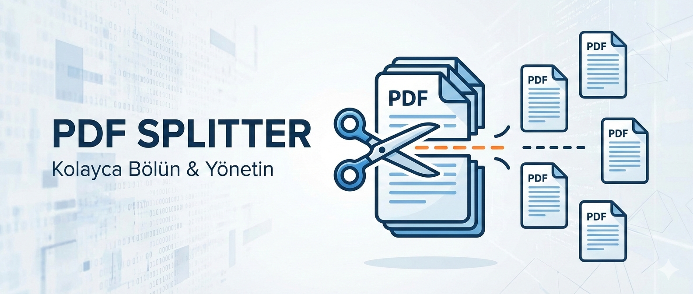

# PDF Splitter ✂️

<p align="center">
  
</p>


**PDF Splitter**, büyük PDF dosyalarını saniyeler içinde daha küçük parçalara ayırmanızı ve birleştirmenizi sağlayan, kullanıcı dostu ve hızlı bir masaüstü/web uygulamasıdır.


---

## 📑 İçindekiler
- [Özellikler](#-özellikler)
- [Kurulum](#-kurulum)
- [Katkıda Bulunma](#-katkıda-bulunma)
- [Lisans](#-lisans)
- [İletişim](#-iletişim)

---

## 🚀 Özellikler

* **Sayfa Aralığı Seçimi:** Belirlediğiniz sayfa aralıklarını (örn. 1-5, 10-12) ayrı dosyalar olarak kaydedin.
* **Tekil Sayfa Ayırma:** Her sayfayı ayrı bir PDF dosyası olarak dışa aktarın.
* **Sürükle ve Bırak:** Dosyaları kolayca arayüze sürükleyerek işlem yapın.
* **Hızlı İşleme:** Optimize edilmiş algoritması ile büyük dosyaları bile saniyeler içinde bölün.
* **Güvenli:** Tüm işlemler yerel makinenizde gerçekleşir, dosyalarınız sunucuya yüklenmez.

---


## ⚙️ Kurulum

Projeyi yerel makinenizde çalıştırmak için aşağıdaki adımları izleyin.

### Adım Adım Kurulum

1.  **Repoyu klonlayın:**
    ```bash
    git clone [https://github.com/MrDeha/PDF-Splitter](https://github.com/MrDeha/PDF-Splitter)
    cd pdf-splitter
    ```

2.  **Gerekli paketleri yükleyin:**
    *Python için örnek:*
    ```bash
    pip install -r requirements.txt
    ```
    *Node.js için örnek:*
    ```bash
    npm install
    ```

3.  **Uygulamayı çalıştırın:**
    ```bash
    [Çalıştırma kodu, örn: python main.py veya npm start]
    ```

---


## 🤝 Katkıda Bulunma

Katkılarınızı bekliyoruz! Lütfen şu adımları izleyin:

1.  Bu repoyu forklayın (Fork).
2.  Yeni bir özellik dalı oluşturun (`git checkout -b feature/YeniOzellik`).
3.  Değişikliklerinizi commit yapın (`git commit -m 'Yeni özellik eklendi'`).
4.  Dalınızı pushlayın (`git push origin feature/YeniOzellik`).
5.  Bir Pull Request (PR) oluşturun.

---

## 📝 Lisans

Bu proje [MIT Lisansı](LICENSE) altında lisanslanmıştır. Daha fazla bilgi için `LICENSE` dosyasına bakabilirsiniz.

---

## 📞 İletişim

Proje Sahibi: **Deha Çelik**

* GitHub: [@MrDeha](https://github.com/MrDeha)
